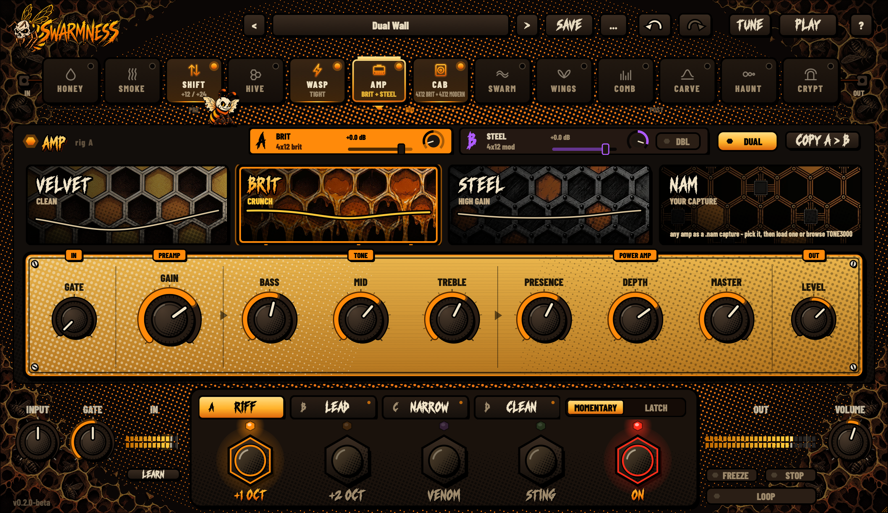
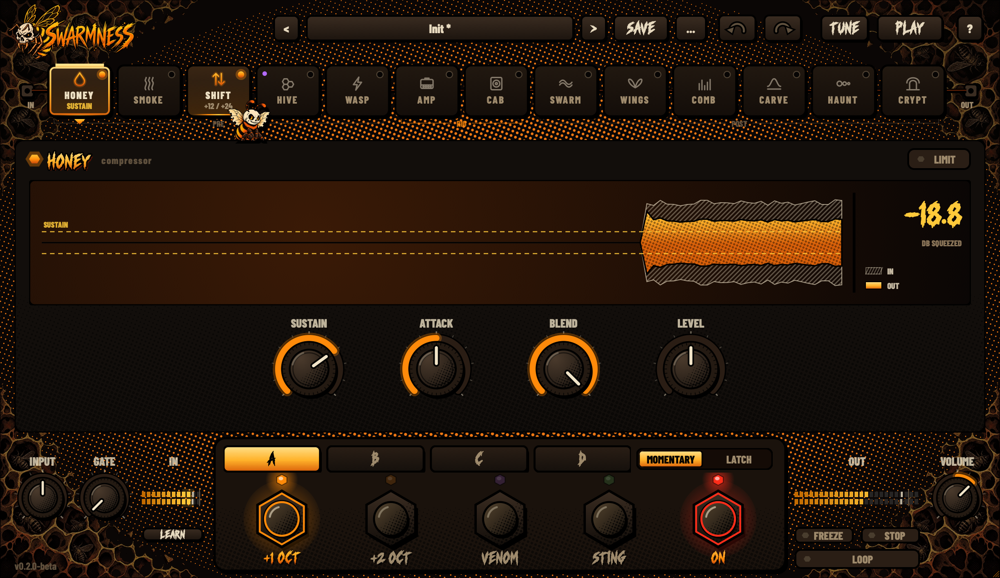
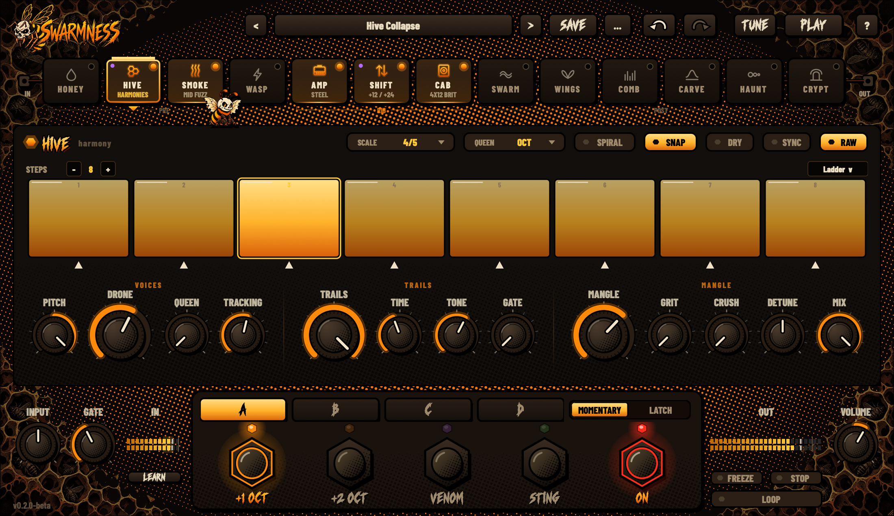
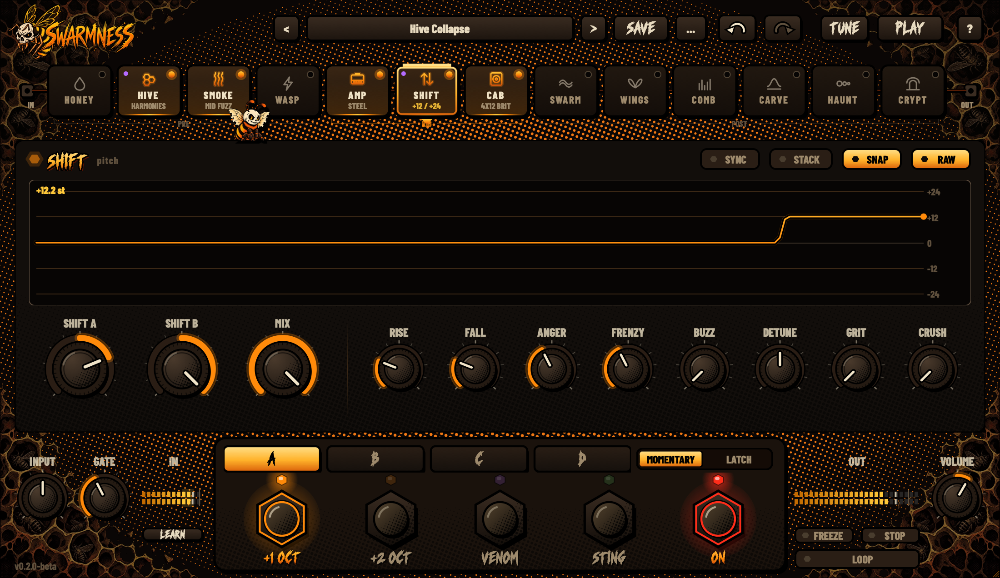
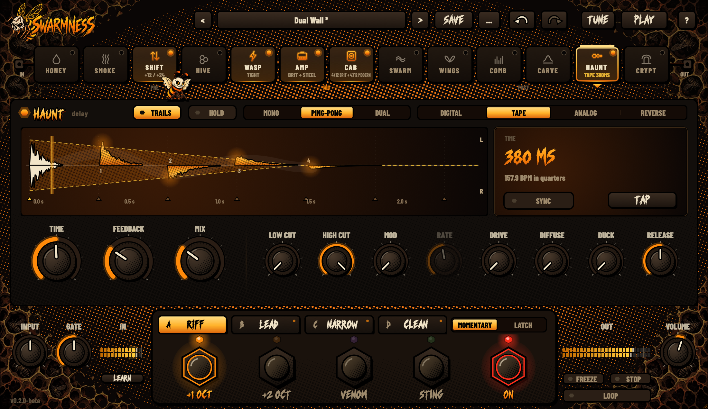
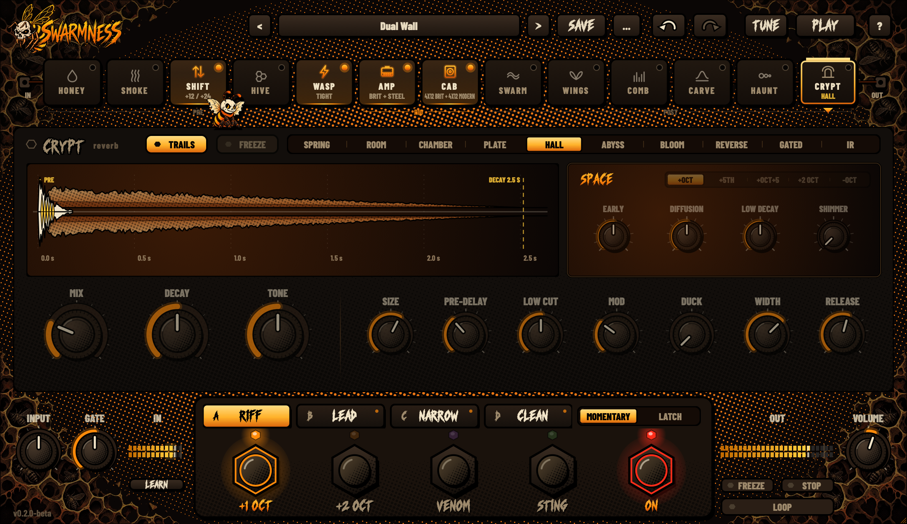
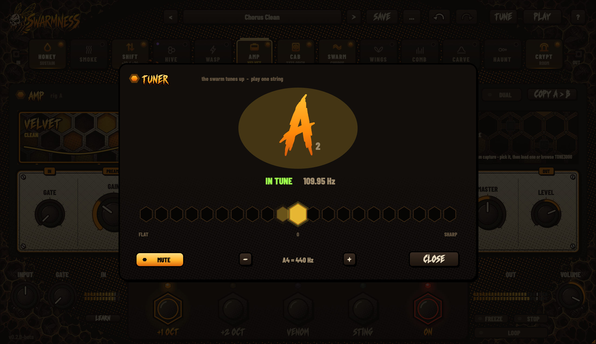

# Swarmness

*[Русский →](README.md)*

**A guitar rig as a plug-in: amps and cabinets, fuzz, overdrive, pitch and octaves, modulation, delay, reverb and a tuner in one chain.** Built for heavy music, at home with clean tones too.

VST3 · AU · Standalone - macOS (Apple Silicon and Intel), Windows, Linux. Free.

### [⬇ Download](https://github.com/danilivnsmir-hub/swarmness/releases)

More screenshots

## What's inside

Thirteen blocks in one chain. Drag the tiles to change their order.

| Block | What it does |
|---|---|
| **HONEY** | compressor / sustainer |
| **SMOKE** | fuzz |
| **SHIFT** | pitch shifter on footswitches: octaves down and up, dives |
| **HIVE** | harmonies and pitch-shifting repeats: ladders, melodies of repeats in key, a metallic spiral |
| **WASP** | overdrive / boost, four characters |
| **AMP** | three amps (CLEAN, CRUNCH, LEAD) and your NAM captures; two rigs, A / B |
| **CAB** | miked cabinets or your IRs |
| **SWARM** | chorus, flanger, phaser, vibe, rotary |
| **WINGS** | tremolo, rhythmic filter, stutter |
| **COMB** · **CARVE** | graphic and parametric EQs |
| **HAUNT** | delay: digital, tape, analog, reverse |
| **CRYPT** | reverb: room, plate, hall, spring, shimmer, your own IR |

Plus a looper, a tuner, four scenes per preset, four footswitches, MIDI learn and about a hundred presets.

## Install

**macOS.** Open `Swarmness-…-macOS-Universal.pkg`; it installs to `/Library/Audio/Plug-Ins`. The builds are not notarized by Apple, so macOS may refuse to open the installer. If it does, go to **System Settings → Privacy & Security** and click **Open Anyway**.

**Windows.** Run `Swarmness-…-Windows-x64-Setup.exe`. The VST3 goes to `C:\Program Files\Common Files\VST3`.

**Linux.** Unzip `Swarmness-Linux-x64.zip`: put `Swarmness.vst3` in `~/.vst3/` and the app wherever you like.

Then re-scan plug-ins in your DAW. Without a DAW, play through the **Swarmness** app (Standalone).

## Getting started

- **Presets.** The arrows in the header step through presets; click the name to open the browser. The first categories hold presets with four scenes each - a good place to start.
- **Scenes A-D** are different sounds of one preset (verse, chorus, solo...). Double-click a scene to rename it.
- **Footswitches.** **SHIFT A / B** shift the pitch; **VENOM** and **STING** switch whatever you wire to them (right-click a footswitch). **MOMENTARY / LATCH** sets whether they act while held or until pressed again.
- **The chain.** Click a tile to open the block's page, drag it to reorder, click the tile's LED to switch the block on or off.
- **?** in the header turns on help: tap any control to see what it does.
- **Undo.** The arrows in the header, or **Cmd/Ctrl+Z**.
- **TUNE** opens the tuner.
- **LOOP** (under the OUT meter) is a looper: tap = record, tap = the loop plays, tap = overdub; double tap = stop, hold = clear. It keeps playing whatever you switch.
- **MIDI.** Right-click any control → **MIDI Learn**, then press a pedal or turn a controller.
- **NAM and IRs.** Drop a `.nam` on the AMP page or a `.wav` on the CAB page.

## Requirements

- macOS 10.15 or later;
- Windows 10 / 11, 64-bit;
- Linux x64.

You need any DAW that hosts VST3 or AU, or you can run it as a standalone app.

## Support

Swarmness is free. If it is useful to you, you can support it on [Boosty](https://boosty.to/insectaudio).

## Licence

© 2026 Insect Audio - the name under which the author publishes Swarmness. All rights reserved.

Swarmness is free for personal use and for making music, commercial recordings and shows included. You may not redistribute, sell, decompile or modify it - share a link to this page instead. Full terms are in [LICENSE](LICENSE); third-party components are listed in [THIRD_PARTY_NOTICES.md](THIRD_PARTY_NOTICES.md).
